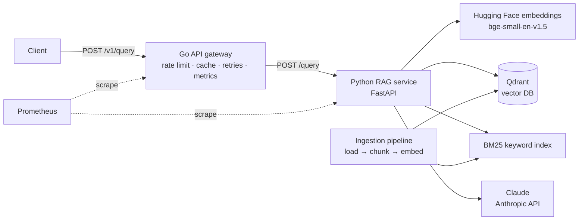

# RAG-Powered Medical Query Assistant

A Retrieval-Augmented Generation (RAG) system that answers healthcare questions from a curated
medical knowledge base, with cited sources, abstention when the answer isn't in the knowledge
base, and emergency-symptom detection.

**Stack:** Python · Go · LlamaIndex · LangChain · Hugging Face · Qdrant (vector database) · Claude · FastAPI · Prometheus · Docker

> ⚠️ Educational project. Answers are general health information, not medical advice.

## Architecture



**Request flow:** gateway validates → per-client rate limit → answer cache → RAG service retrieves
top-k passages (dense vector search via LlamaIndex + Qdrant, fused with BM25 using reciprocal rank
fusion) → versioned LangChain prompt → Claude generates a cited answer → safety layer adds an
emergency notice when needed.

| Component | What it does |
|---|---|
| `rag_service/app/ingest.py` | Data pipeline: parse markdown + frontmatter, section-aware chunking (LangChain splitters), embed (Hugging Face), index into Qdrant via LlamaIndex |
| `rag_service/app/retriever.py` | Dense retriever, BM25 retriever, reciprocal rank fusion |
| `rag_service/app/prompts.py` | Versioned prompt templates (v1 baseline, v2 grounded + citations + abstention) |
| `rag_service/app/llm.py` | Claude via the official Anthropic SDK; offline extractive fallback for tests/CI |
| `rag_service/app/server.py` | FastAPI: `/query`, `/healthz`, `/readyz`, `/metrics` |
| `rag_service/eval/run_eval.py` | Evaluation harness comparing configurations on a labeled test set |
| `gateway/` | Go microservice: validation, token-bucket rate limiting, LRU+TTL cache, retries with backoff, request IDs, structured logs, Prometheus metrics, graceful shutdown |

## Evaluation

The test set (`data/eval/testset.jsonl`) has **38 questions**: 32 answerable from the knowledge base
(each labeled with its source document and the facts a correct answer must contain) and 6
out-of-scope questions the system should decline.

Two configurations are compared:

| Knob | `baseline` | `tuned` |
|---|---|---|
| Chunking | 1500 chars, fixed size | 600 chars, 100 overlap, split on markdown sections first |
| Embedded text | chunk text only | chunk + document title + section ("contextual headers") |
| Query embedding | raw question | BGE retrieval instruction prefix |
| Retrieval | dense, top-2 | hybrid dense + BM25 with reciprocal rank fusion, top-4 |
| Prompt | v1 (minimal) | v2 (grounding rules, citations, explicit abstention, safety) |

**Measured results — offline mode** (`--llm extractive`, no API key; the generator is a simple
sentence-extractor, so answer accuracy here is a lower bound):

| Profile | Hit@k | MRR | Answer accuracy (in-scope) | Abstention (out-of-scope) | **Overall accuracy** |
|---|---|---|---|---|---|
| baseline | 0.969 | 0.969 | 0.438 | 1.000 | **52.6%** |
| tuned | 1.000 | 1.000 | 0.594 | 0.833 | **63.2%** |

Tuning improved overall accuracy by **+10.5 points (+20% relative)** and retrieval reached 100%
hit rate. In tuned mode, every remaining in-scope miss had the correct document retrieved; the
failures come from the extractive stand-in generator, not retrieval.

To measure end-to-end accuracy with Claude generating the answers (requires `ANTHROPIC_API_KEY`;
makes ~76 API calls):

```bash
python -m eval.run_eval --llm claude
```

Per-question results are written to `rag_service/eval/results/`.

## Quickstart

### Local (Python 3.11)

```bash
python -m venv .venv
.venv/Scripts/activate            # Windows  (macOS/Linux: source .venv/bin/activate)
pip install torch --index-url https://download.pytorch.org/whl/cpu
pip install -r rag_service/requirements.txt

cd rag_service
python -m app.ingest              # build both profiles' indexes (embedded Qdrant under ./storage)
export ANTHROPIC_API_KEY=...      # or RAG_LLM_PROVIDER=extractive to run with no key
uvicorn app.server:app --port 8001
```

```bash
curl -X POST localhost:8001/query -H "Content-Type: application/json" \
  -d '{"question": "What A1C level means you have diabetes?"}'
```

### Full stack (Docker Compose)

```bash
cp .env.example .env              # add ANTHROPIC_API_KEY
docker compose up --build
```

| Service | URL |
|---|---|
| Gateway (public API) | http://localhost:8080/v1/query |
| RAG service | http://localhost:8001/docs |
| Qdrant dashboard | http://localhost:6333/dashboard |
| Prometheus | http://localhost:9090 |

### Example response

```json
{
  "answer": "Diabetes is diagnosed with an A1C of 6.5% or higher [1]. ...",
  "sources": [{"id": 1, "doc_id": "type2_diabetes", "title": "Type 2 Diabetes", "section": "Diagnosis", "score": 0.0328, "snippet": "..."}],
  "profile": "tuned",
  "model": "claude-opus-5-5",
  "emergency": false,
  "disclaimer": "This is general health information, not medical advice. ...",
  "timings_ms": {"retrieve": 41.2, "generate": 2310.5}
}
```

## Testing

```bash
cd rag_service && pytest -q                 # 23 tests: ingestion, retrieval, prompts, safety, API, eval scoring
cd gateway && go test -race ./...           # rate limiter, cache, retries, HTTP handlers
```

CI (GitHub Actions) runs both suites, ingests the corpus with real embeddings, and fails the build if
tuned-profile accuracy drops below 60% (`--min-accuracy 0.6`) — a retrieval-quality regression gate.

## Monitoring

- **Gateway:** `gateway_requests_total`, `gateway_request_duration_seconds`, `gateway_cache_hits_total`, `gateway_rate_limited_total`, `gateway_upstream_errors_total`
- **RAG service:** `rag_queries_total`, `rag_stage_latency_seconds{stage="retrieve|generate"}`, `rag_llm_tokens_total`

## Configuration

RAG service (`RAG_` prefix): `RAG_LLM_PROVIDER` (`claude`/`extractive`), `RAG_CLAUDE_MODEL`,
`RAG_CLAUDE_EFFORT`, `RAG_QDRANT_URL`, `RAG_EMBED_MODEL`, `RAG_DEFAULT_PROFILE`.

Gateway: `GATEWAY_ADDR`, `RAG_SERVICE_URL`, `GATEWAY_REQUEST_TIMEOUT`, `GATEWAY_MAX_RETRIES`,
`GATEWAY_RATE_LIMIT_RPS`, `GATEWAY_RATE_LIMIT_BURST`, `GATEWAY_CACHE_TTL`, `GATEWAY_CACHE_SIZE`.

## Knowledge base

`data/corpus/` contains 12 general-information articles (hypertension, type 2 diabetes, asthma,
influenza, migraine, iron-deficiency anemia, hypothyroidism, GERD, UTI, stroke, heart attack,
dehydration) written for this project. Add more `.md` files with `title`/`category` frontmatter and
re-run `python -m app.ingest`.
